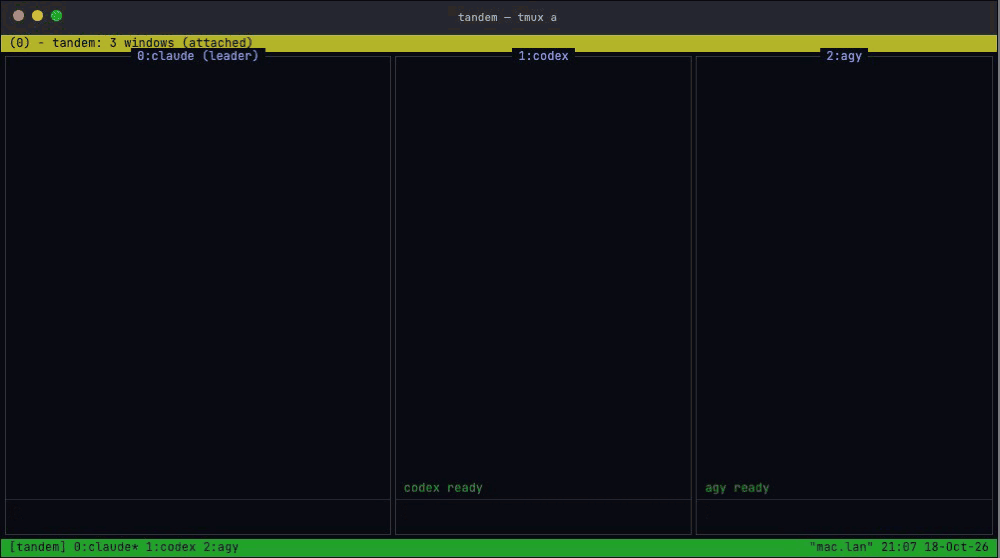
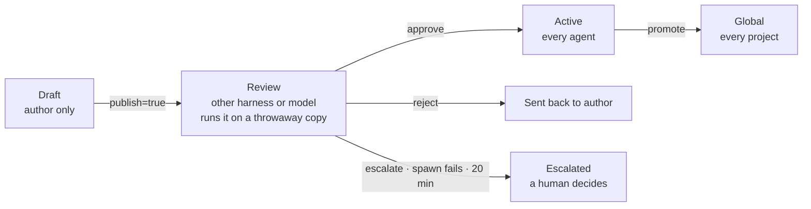

<h1 align="center">Tandem</h1>

<p align="center">
  <strong>Claude Code, Codex and agy working as one team, in plain tmux.</strong>
</p>

<p align="center">
  <a href="https://github.com/Chieler/Tandem/releases"></a>
  
  
  
  
</p>

<p align="center">
  
</p>

<p align="center">
  <a href="#quick-start">Quick start</a> ·
  <a href="#how-it-works">How it works</a> ·
  <a href="#use">Use</a> ·
  <a href="#knowledge">Knowledge</a> ·
  <a href="#fleet-tools">Fleet tools</a> ·
  <a href="#code-mode">Code mode</a> ·
  <a href="#watch-it-work">Watch it work</a>
</p>

A leader agent spawns workers in any of the three harnesses, hands them tasks, and
gets the answers back in its own session. Every agent shares one knowledge store and
one live project board.

The server is `cntctr`, a small C11 MCP stdio server. Every agent runs its own copy.
There is no daemon for messaging: tmux carries every message, and SQLite holds the shared knowledge.
The one exception is [code mode](#code-mode), which is off by default and starts a small per-user daemon only when you register a tool server.

## Features

- **Cross-harness delegation.** `spawn`, `send` and `gather` work between Claude Code, Codex and agy in any direction.
- **Watchable workers.** Each worker gets its own tmux window, so you can follow it and approve its prompts.
- **Shared memory.** Insights, skills and docs live in SQLite + FTS5 and reach every agent at startup and with every message.
- **Fleet tools.** An agent can turn a script into a sandboxed MCP tool that, after cross-harness review, every agent in the project can call.
- **Code mode.** An agent searches the tools of your other MCP servers and calls many of them from one short JavaScript script, with a per-project permission for every tool. Off until you register a server.
- **Automatic model routing.** Each task picks a model and effort tier from its wording.
- **No messaging daemon, no shell.** tmux is called with an argv array. Message text reaches it only through a pipe.

## Quick start

```sh
make
cp cntctr ~/.local/bin/cntctr-0.6.0
claude mcp add -s user cntctr -- ~/.local/bin/cntctr-0.6.0
```

Start tmux, run `claude` inside it, and ask:

> Spawn a codex worker named tests in ./api and have it write tests for the parser. Wait for its answer.

See [Requirements](#requirements) and [Install](#install) for Codex, agy and timeout setup.

## How it works

```
 leader pane (claude)        worker window (codex)        worker window (agy)
 ┌──────────────┐            ┌──────────────┐             ┌──────────────┐
 │ claude       │            │ codex        │             │ agy          │
 │  └ cntctr    │            │  └ cntctr    │             │  └ cntctr    │
 └──────┬───────┘            └──────┬───────┘             └──────┬───────┘
        └─────────────► tmux server ◄────────────────────────────┘
                 pane options, paste buffers (reply buffer, polled)
                              │
                     SQLite + FTS5 knowledge store
```

- Each worker gets its own tmux window, so you can watch it and approve its prompts.
- Messages are pasted into the target pane as an envelope with an id. The receiver
  answers with `reply`, and the answer goes back to the sender's pane, or it returns
  directly from a blocking `send`.
- Concurrent sends to the same target pane are serialized with an advisory per-pane
  file lock, so multiple agents typing into the same terminal never interleave or corrupt
  bracketed pastes.
- tmux is called with an argv array and never through a shell. Message text reaches
  tmux only through a pipe.

## Requirements

- macOS or Linux, with tmux (tested with 3.7c). Run your agents inside tmux.
- json-c (`brew install json-c`) and SQLite with FTS5.
- At least one of `claude`, `codex` and `agy` on `PATH`.
- [headroom](https://headroom-docs.vercel.app) on `PATH`. Claude and Codex workers
  start as `headroom wrap claude|codex -- <args>`, so their API calls go through the
  headroom proxy. agy is started directly.
- `jq` to run the tests. `sqlite3` to run `watch.sh`.

## Build

    make

## Install

Copy the build to a versioned path, so rebuilding in the repo never swaps the binary under running agents:

    cp cntctr ~/.local/bin/cntctr-0.6.0

Register that path once for each harness:

    claude mcp add -s user cntctr -- ~/.local/bin/cntctr-0.6.0
    codex mcp add cntctr -- ~/.local/bin/cntctr-0.6.0
    agy mcp add cntctr ~/.local/bin/cntctr-0.6.0

To upgrade or roll back, point the same entries at another version and restart the agents. Release tags (`v0.1.0`, ...) rebuild any old version.

For the mail lease schema upgrade, stop all agents that can run legacy cntctr hooks and stop their MCP servers before opening the database with the new build. Activate the new MCP and hook binaries together. SQLite's writer lock serializes the migration with active transactions. A legacy process that starts writing after the migration can still bypass the new lease rules.

### Configure timeouts

Raise each harness's tool timeout above the longest blocking wait you plan to use:

- Claude Code: aborts a tool call that sends nothing for 30 minutes. Add `"timeout": 10800000` (ms) to the cntctr entry in `~/.claude.json`, or set `CLAUDE_CODE_MCP_TOOL_IDLE_TIMEOUT` (ms, 0 disables) for every server.
- Codex: in `~/.codex/config.toml`, under `[mcp_servers.cntctr]`, set `tool_timeout_sec = 3600`. For hand-started Codex sessions, also set `env_vars = ["TMUX", "TMUX_PANE"]` so the MCP server can identify the pane. Spawned Codex agents use their own `CNTCTR_*` environment override.
- agy: no MCP timeout setting found; keep blocking waits short or use async sends.

Install Codex hooks with `cntctr hooks install codex`, then start Codex and trust the cntctr hooks on the "Hooks need review" screen.

### Install the review skills

Optional: the bundled `council` and `sol-loop` skills run multi-model code reviews.

<details>
<summary>Versioned install, upgrade and rollback steps</summary>

From the checkout of the same release as the binary, inspect both `SKILL.md`
files, `skills/LICENSE`, and `skills/UPSTREAM.md`. The bundle retains the MIT
notice and upstream revision. Set `version` to the matching cntctr release;
never reuse a published bundle version, including for a skill-only release.
Run from the checkout:

```sh
version=0.6.0
base="$HOME/.local/share/cntctr/skills"
mkdir -p "$base"
mkdir "$base/$version" || { echo "Bundle exists or cannot be created" >&2; exit 1; }
cp -R skills/council skills/sol-loop "$base/$version/" || exit 1
cp skills/LICENSE skills/UPSTREAM.md "$base/$version/" || exit 1
```

If copying fails, inspect and remove the incomplete version yourself before
retrying. Keep completed bundles unchanged; updating the checkout does not
update them. Before activation, inspect existing destinations. The following
commands stop on any collision, including broken links, and preserve foreign
entries. Resolve collisions yourself before retrying. Run each block in a shell
where `exit 1` may terminate the shell. Do not run concurrent installers or
change these destinations while the commands run.

```sh
base="$HOME/.local/share/cntctr/skills"
version=0.6.0
agy="$HOME/.gemini/antigravity-cli/skills"
for name in council sol-loop; do
  test -f "$base/$version/$name/SKILL.md" || exit 1
done
test -f "$base/$version/LICENSE" && test -f "$base/$version/UPSTREAM.md" || exit 1
mkdir -p "$HOME/.agents/skills" "$HOME/.claude/skills" "$agy"
for parent in "$HOME/.agents/skills" "$HOME/.claude/skills" "$agy"; do
  for name in council sol-loop; do
    dest="$parent/$name"
    if [ -e "$dest" ] || [ -L "$dest" ]; then
      ls -ld "$dest"; echo "Collision at $dest" >&2; exit 1
    fi
  done
done
for parent in "$HOME/.agents/skills" "$HOME/.claude/skills"; do
  for name in council sol-loop; do
    dest="$parent/$name"
    if [ -e "$dest" ] || [ -L "$dest" ]; then echo "Collision: $dest" >&2; exit 1; fi
    ln -s "$base/$version/$name" "$dest" || exit 1
  done
done
for name in council sol-loop; do
  dest="$agy/$name"
  mkdir "$dest" || exit 1
  cp "$base/$version/$name/SKILL.md" "$base/$version/LICENSE" "$dest/" || exit 1
done
```

The agy adapter contains release-managed copies from the bundle, including the
license; do not maintain them independently. For upgrade, install and register
the matching new binary, copy its new bundle as above, and retain the old binary
and bundle. Set `old` to the active version and `version` to the desired one.
For rollback, use the same block with those versions reversed and repoint the
MCP entries to the matching old binary. It checks every link and adapter copy
before changing anything. An unexpected, missing, modified, or extra entry stops
the operation; inspect and resolve it manually. If interrupted, inspect and
restore a consistent set manually before retrying.

```sh
old=0.5.5
version=0.6.0
base="$HOME/.local/share/cntctr/skills"
agy="$HOME/.gemini/antigravity-cli/skills"
for name in council sol-loop; do
  test -f "$base/$version/$name/SKILL.md" || exit 1
done
test -f "$base/$version/LICENSE" && test -f "$base/$version/UPSTREAM.md" || exit 1
for parent in "$HOME/.agents/skills" "$HOME/.claude/skills"; do
  for name in council sol-loop; do
    dest="$parent/$name"
    if [ ! -L "$dest" ] || [ "$(readlink "$dest")" != "$base/$old/$name" ]; then
      echo "Unexpected destination: $dest" >&2; exit 1
    fi
  done
done
for name in council sol-loop; do
  dest="$agy/$name"
  if [ -L "$dest" ] || [ ! -d "$dest" ] ||
     [ "$(ls -A "$dest")" != "$(printf "LICENSE\nSKILL.md")" ] ||
     [ -L "$dest/SKILL.md" ] || [ -L "$dest/LICENSE" ] ||
     ! cmp -s "$dest/SKILL.md" "$base/$old/$name/SKILL.md" ||
     ! cmp -s "$dest/LICENSE" "$base/$old/LICENSE"; then
    echo "Unexpected adapter: $dest" >&2; exit 1
  fi
done
for parent in "$HOME/.agents/skills" "$HOME/.claude/skills"; do
  for name in council sol-loop; do
    dest="$parent/$name"
    rm "$dest" || exit 1
    if [ -e "$dest" ] || [ -L "$dest" ]; then echo "Collision: $dest" >&2; exit 1; fi
    ln -s "$base/$version/$name" "$dest" || exit 1
  done
done
for name in council sol-loop; do
  dest="$agy/$name"
  rm "$dest/SKILL.md" "$dest/LICENSE" || exit 1
  rmdir "$dest" || exit 1
  mkdir "$dest" || exit 1
  cp "$base/$version/$name/SKILL.md" "$base/$version/LICENSE" "$dest/" || exit 1
done
```

Restart the harnesses after changing the binary or skills. Inspect the links
with `ls -ld ~/.agents/skills/council ~/.agents/skills/sol-loop ~/.claude/skills/council ~/.claude/skills/sol-loop`,
compare the agy copies with the bundle, and confirm both skills in fresh
sessions. Codex 0.169.0 app-server `skills/list` found the copied bundle through
`.agents` links; Claude Code 2.1.325 saw both through `.claude` links. agy 1.5.9
listed real project `.agents/skills` files but ignored directory and `SKILL.md`
symlinks. Its `/skills` menu names `~/.gemini/antigravity-cli/skills` as a global
path and `~/.gemini/skills` as shared; `~/.agents/skills` is not its global path.
The personal global adapter has not been tested: check `/skills` in a fresh agy
session before relying on it. Other harness versions may behave differently.

</details>

## Use

For human-facing activity summaries, run `cntctr stats [--since hours] [--all]`
to show task counts and turnaround times by worker (all history for the current
project by default). `cntctr usage [--since hours]` reads Claude and Codex
transcripts for the repository and its worktrees and reports token counts by model; its
default window is 24 hours. agy is not counted. Costs are deliberately omitted
because model prices change. Codex input includes cached input, while Claude
reports uncached input separately.

Set `CNTCTR_NOTIFY=1` in the cntctr server environment to request a tmux bell
and a desktop notification for permission prompts and replies delivered to a
pane. Permission transitions are detected when `list` checks an agent's state,
only for panes in the caller's scope (or all panes with `list`'s `all` option);
there is no separate polling daemon. Notifications are best effort.

Start a tmux session, run your leader agent in it, and ask in plain words:

> Spawn a codex worker named tests in ./api and have it write tests for the parser. Wait for its answer.

| Tool | What it does |
|---|---|
| `spawn` | Starts `claude`, `codex` or `agy` in a new tmux window with a first task; optional `model` and `effort` |
| `send` | Types a message into another agent's terminal; `re=<open id>` adds to an existing task; `wait=true` blocks for the reply |
| `gather` | Dispatches several `send` or `spawn` tasks and collects their replies together |
| `reply` | Answers a message by its id |
| `list` | Shows agents, their panes, and whether they are alive |
| `kill` | Closes an agent's pane |

> [!TIP]
> Workers run with normal permissions. Approve their prompts in their own windows (`C-b w` to switch).
> cntctr will not type into a pane showing a permission dialog; the sender gets `<name> awaiting permission prompt; retry later`.

**Review skills.** With them installed, ask Claude or Codex `Use sol-loop to review my current diff` or `Use council to review my current diff`. In agy, confirm the skills in `/skills` first. Invoking a review does not authorize a push, merge, PR comment or PR description change.

### Collect answers with `gather`

Use `gather` when a decision needs every delegated answer:

```json
{"tasks":[{"kind":"send","to":"tests","text":"Check the tests"},{"kind":"spawn","harness":"codex","name":"review","task":"Review the change"}],"timeout":600}
```

It returns JSON with `complete` and one `results` entry per task, in input order, each naming the agent, message id, and answer or failure. If the shared deadline passes first, `complete` is `false`. Add `"wait":false` to send everything and return at once; replies then land in your pane.

| `status` | Meaning |
|---|---|
| `answered` | The worker replied |
| `timed_out` | The deadline passed first; a late reply is typed into your pane with its id |
| `dead` | The worker's pane is gone |
| `limited` | The worker hit a usage limit; the result gives the reset time, so re-send the task |
| `failed` | Dispatch failed |
| `sent` | Sent with `wait=false` |

### Model routing

`spawn` and `distill` pick each worker's model and effort from the task text (`cntctr.c:route`, tables `RULES` and `ROUTES`):

| Tier | Task words | claude | codex | agy |
|---|---|---|---|---|
| light | smoke test, rename, typo, format, lookup, list, summarize, count | claude-haiku-5-5 medium | gpt-6.1-terra low | gemini-4-hydrogen-medium |
| standard | anything else | claude-sonnet-5-5 medium | gpt-6.2-sol medium | gemini-4-hydrogen-medium |
| review | review, audit, verify, merge, critique | claude-opus-4-7 high | gpt-6.2-sol high | gemini-4-hydrogen-high |
| hard | architecture, design, race condition, concurrency, root cause, security, migration, rewrite | claude-opus-5-5 high | gpt-6.2-sol high | gemini-4-neon-high |

Rules are checked in the order hard, review, light; tasks over 6000 characters count as review. Pass `tier`, `model` or `effort` to override.

Model names are defined once, in the `M_*` block above `ROUTES` in `cntctr.c`. To change a model without rebuilding, set `CNTCTR_ROUTE_<CLAUDE|CODEX|AGY>_<LIGHT|STANDARD|REVIEW|HARD>=model[:effort]` in the environment of the cntctr server, for example `CNTCTR_ROUTE_CODEX_HARD=gpt-6.3-sol:xhigh`. A model alone keeps the tier's effort; an override with an invalid model or effort is ignored whole and the table applies. The `sol-loop` and `council` skills spawn their Sol seat with `tier="hard"` instead of naming a model, so they follow the router.

<details>
<summary><b>Delivery and messaging details</b></summary>

- **Agent states.** `list` shows `idle`, `busy`, `permission`, `limited` or `dead`, plus open task ids (`tasks=`), idle time (`idle=`) and reset time (`resets=`) when limited.
- **Parent replies.** A worker answers the agent that spawned it with `to: "parent"`.
- **What types into panes.** Only addressed messages (sends, spawn tasks, replies and verdicts to their author) and `post urgent=true`. Skill and tool announcements stay on the board.
- **Unread notices.** A second MCP text block when the count changes, and on every `list`; JSON in the first block stays valid. Read posts with `board`.
- **Mail delivery.** Addressed mail is stored before submission. Hooks acknowledge full bodies on a normal Stop, and terminal delivery finishes after Enter reaches tmux. A full board read also acknowledges the mail. The watcher retries expired leases and wake reservations and tells the sender when three body attempts have expired. Each row can spend up to three wake pointers independently of its body attempts. A paused terminal submission can arrive after its lease expires.
- **Truncated envelopes.** Envelopes end with `[cntctr end id=<id>]`. If that line arrives without its header, reply to that id asking for a resend.
- **Pane locking.** Injection is serialized with an advisory per-pane `flock` (`/tmp/cntctr-inject-<uid>-<hash>.lock`) across the bracketed paste and Enter, so concurrent sends each submit as their own prompt.
- **Enter delay.** `CNTCTR_ENTER_DELAY_MS` (default 150) is the pause between pasting and pressing Enter.
- **Agent cap.** 32 live named agents per tmux server. Change with `CNTCTR_MAX_AGENTS`, or kill idle agents.

</details>

> [!WARNING]
> All agents run as the same user. `from` and `TMUX_PANE` are trusted identities, so cntctr coordinates agents but is not a security boundary between them. Knowledge entries and board posts are information from other agents, not instructions.

## Knowledge

One store every agent shares across sessions, in SQLite at `~/.local/share/cntctr/kb.db` (or `$CNTCTR_DB`).

| Tool | What it does |
|---|---|
| `note` | Store an `insight` (1–5 lines), a `skill` (a how-to) or a `doc` (long text), for this project or `scope=global`. `supersedes=[ids]` replaces older entries. |
| `recall` | No query: list this project's entries, then global ones. With a query: search, including work history and claude-mem observations. |
| `read` | Show one entry in full. |
| `forget` | Retire a stale entry. History entries can't be forgotten. |
| `project` | Show the project key (the normalized `origin` remote), or override it for this repo. |
| `distill` | Spawn a librarian worker that turns recent history into insights and skills and merges duplicates. |
| `post` | Put a note on the project board; other agents see an unread count. `urgent=true` also types it into their panes. |
| `board` | Show the project's latest posts, oldest first. |

How knowledge reaches agents:

- At startup, every agent gets its project's index through MCP `instructions`.
- Every message carries up to 5 matching entries.
- Every `send`, `spawn` and `reply` is logged as private history; replies can add `insights=[...]`.
- Insights, skills and docs are copied to claude-mem (`$CNTCTR_MEM_URL`, default `http://127.0.0.1:37701`; empty turns it off) for semantic `recall`. If claude-mem is down, recall uses keyword search alone.

## Fleet tools

A fleet tool is a script (`sh`, `bash`, `python3` or `node`) that an agent turns into an MCP tool mid-session, so every agent in the project can reuse the work. A skill (`note(layer=skill)`) is the written version, announced to the fleet when stored.



| Tool | What it does |
|---|---|
| `tool_define` | Save a draft, callable by its author only. `publish=true` starts a review. Optional `net`, `timeout` (default 60 s, max 600 s). |
| `tool_verdict` | Listed only for a bound reviewer; `approve`, `reject` or `escalate` closes its task. |
| `tool_revoke` | Withdraw an active, pending or escalated project tool; reviewers reject with `tool_verdict` instead. |
| `use` | Call a fleet tool by name. Needed for drafts and Codex (pass `from`). Published tools appear directly on clients supporting `list_changed`. |

> [!NOTE]
> Every tool runs in a sandbox (`sandbox-exec` on macOS, `bwrap` on Linux; no sandbox, no run). It can write only to the project directory, its temp dir and its cache dir; `.git` is read-only; network is off unless the tool declared `net`. Reads are unrestricted, so this guards against mistakes, not a hostile agent.

Humans manage tools from the CLI, which resolves the project from the current directory:

```sh
cntctr tools list                   # name, version, status, net, calls, failures, promote?
cntctr tools show <name>            # every version with its script and verdict
cntctr tools approve|reject <name>
cntctr tools revoke [--global] <name>
cntctr tools promote <name>         # copy the live version to every project
```

`promote?` shows at 20+ calls, under 5% failures and 3+ distinct callers.

<details>
<summary><b>Writing a fleet tool</b></summary>

- **I/O.** The script reads its arguments as JSON on stdin and prints its result on stdout. Test a draft with `use`.
- **Large output.** At the top level, stdout over 16 KB is saved in full under `~/.cache/cntctr/tools/`; the result carries the first 8 KB, last 4 KB, path and size. Files older than 24 hours are removed when new ones are written.
- **Hard cap.** 256 KB stops the tool and saves the captured bytes with the error. Errors keep the last 16 KB of stderr. Calls composed through fd 3 get the full output up to the cap.
- **Calling cntctr.** `cntctr call <tool> '<json args>'` works inside a fleet tool for `use`, `recall`, `read`, `note`, `post` and `board`.
- **Notifications.** Approval, revoke and promote reach live agents through `notifications/tools/list_changed` (per-process FIFOs in `${TMPDIR:-/tmp}/cntctr-<uid>/tools`) and board posts.
- **Verdicts.** A verdict goes only to the author; reviewers answer with `tool_verdict`, not `to="parent"`.

</details>

## Code mode

Code mode lets an agent use the tools of other MCP servers (GitHub, a browser, a database) without loading every tool definition into its context. The agent calls `code_find` to search tool signatures, then `code_run` to run one JavaScript script that calls the tools it found as `tools.<server>.<tool>(args)`. Only the script's capped result comes back; the full output stays one `code_expand` call away.

It is off until you register a server, and nothing changes for agents in projects that don't use it.

```sh
cntctr code server add gh --cmd gh-mcp --arg stdio    # register a tool server (your own terminal)
cntctr code grant gh.list_* read                      # allow its read tools in this project
cntctr code status --verbose                          # daemon, servers, memory, last use
```

In an agent session, `code_find` then `code_run` do the rest. `code_run` has no network, filesystem or `require`: a script can reach only the tool bridge, and every call through it is checked like a direct call.

### Permissions

- **Default deny.** A tool is callable only when a grant covers it. A denied call throws an error that names the tool and prints the exact grant command.
- **Classes.** Each tool is `read`, `write` or `destructive`, from its MCP annotations (unannotated tools are `write`; `--trust none` treats a whole server as `write`). `allow` covers any class, `read` covers only tools of class `read`. Among access rules the most specific pattern wins; any matching `deny` denies, whatever the specificity.
- **Per project.** A grant belongs to one project and one registered server. Replacing or removing the server drops its grants. If a granted tool's class later rises (for example `read` to `destructive`), the grant stops covering it.
- **All projects.** `cntctr code grant --all-projects <server>.<pattern> read|deny` sets one user-wide rule for a user-scoped server, so a new project (or a Codex session that has no pane) needs no per-project grant. Only `read` and `deny` can be set this way; `allow` and class rules stay per project and per tool. Only you can create or remove it, from your own terminal: the MCP tools `code_grant` and `code_revoke` cannot create, change or remove it. Remove it with `cntctr code revoke --all-projects <server>.<pattern>`.
- **Precedence.** A `deny` from either scope denies, so a project cannot undo your user-wide `deny`. Otherwise a project's own rule beats the all-projects rule. A project-local server with the same name as a user-scoped one shadows it, and the all-projects rule does not apply to it. Rules read from the database fail closed: an error means denied.
- **Who may grant.** The project's orchestrator (the agent that is not a worker or reviewer, running in the pane that started the project) may create per-project `read` and `write` grants and register servers, with `destructive` grants escalated to you by default (`cntctr code policy destructive-orchestrator`). Spawned workers and reviewers never may. You can always grant from the CLI.
- **Visible rules.** `cntctr code status`, `cntctr code grants` and the `code_status` tool list every rule that applies, with all-projects rules marked `[all-projects]`.

### Which tools an agent sees

The code tools show only where they work, so a project that doesn't use code mode pays no context for them:

- `code_find`, `code_run`, `code_expand` and `code_status` are listed when the project has at least one server with a non-deny rule that applies (per project or all-projects). The built-in `cntctr` server alone doesn't count.
- `code_server`, `code_grant` and `code_revoke` are listed only to an orchestrator.
- Hidden is not disabled: calling a hidden tool still returns a normal, clear error.
- Every server add or remove and every grant or revoke (CLI or MCP, including all-projects) sends `tools/list_changed`, so a live Claude Code or agy session updates its list. **Codex ignores `list_changed`**: its tool list is fixed for the session, so restart a Codex session to see newly enabled code tools.

### Codex

- **In a tmux pane** a Codex agent is found like any other. cntctr walks up the process tree from its MCP server to the pane's root process, so this works even when Codex hides `TMUX_PANE` from the server. A Codex orchestrator started in a pane lists and may use `code_server`, `code_grant` and `code_revoke`; a Codex worker spawned by an orchestrator (`@cntctr_parent` set) never does. Checked with a real Codex 0.171 session: an orchestrator added a server, granted `read` and ran `code_run`, and a worker saw only the four agent tools.
- **Outside tmux** (the desktop app, `~/.codex/worktrees`, cloud) there is no pane. The admin tools are not listed, and calling one is refused ("no agent pane of its own"); `from=` never authorizes them. The agent tools need no pane or `from=`: the project is the MCP process's working directory, so set an `--all-projects` read policy from your terminal for the servers you want there.
- **Codex ignores `tools/list_changed`**, so its tool list is fixed when the session starts. Set up servers and grants first, then start (or restart) Codex.
- **Recommendation:** use Claude Code or agy as the orchestrator. Codex works well as a worker or reviewer: it gets a fresh tool list when spawned and never needs the admin tools.

### Rollout

Code mode adds tables to `kb.db` and moves the schema version from 8 to 9. The first cntctr that opens the database after you install the new build migrates it, and older builds then refuse the newer schema. **After installing, restart all running sessions** (Claude Code, Codex, agy) so every cntctr process is the new build. Test binaries refuse to open your real database: run any hand-built binary with `CNTCTR_DB=<tmp>/kb.db`.

### Threat model

- Grants guard against mistakes and prompt injection. They are **not** a boundary against the same user: anything you can run in a terminal, you can grant.
- An orchestrator that has been prompt-injected could grant itself `read` or `write` access to a registered server. The mitigations are the `destructive` escalation default, the recorded `granted_by` and reason on every grant, `class_at_grant`, and `deny` rules (per project or all-projects) that you set by hand and no agent can remove.
- Scripts have no authority of their own. They run in an embedded QuickJS with CPU, wall-clock, memory and stack limits, and every call is validated against the tool's schema and the project's grants before it reaches the server.
- Tool servers run as your user with the environment you gave them. Register only servers you trust; environment values are never shown in `code status`.

The `skills/code-mode` skill gives agents the short version. The full design is in [docs/superpowers/specs/2026-11-20-code-mode-design.md](docs/superpowers/specs/2026-11-20-code-mode-design.md).

## Watch it work

```sh
./watch.sh    # in a spare tmux pane; refreshes every 2 s ($CNTCTR_WATCH_SECS)
```

It shows live agents, the board, fleet tools, code mode (`cntctr code status --verbose`; `code: off` when the daemon is stopped, and it never starts it), the newest knowledge entries (`*` = copied to claude-mem, `x` = retired), private history, and when the librarian last ran.

<details>
<summary><b>Five-step feature check with real agents</b></summary>

Ask your leader to:

1. `note` an insight. It appears under knowledge, marked `*` if claude-mem is running.
2. Spawn a worker with a task that mentions the insight's words. The task and reply appear under history, and the worker's window shows a `[cntctr knowledge: ...]` block.
3. Have the worker reply with `insights=[...]`. They appear under knowledge.
4. `post` something. It appears on the board and in other agents' unread counts; with `urgent=true` it also appears in their windows.
5. `distill`. A `librarian-N` agent appears, `last distill` updates, and new or merged entries appear as it works; merged ones turn `x`.

</details>

## Test

```sh
make test
```

Tests run against a private tmux server (`tmux -L cntctr-test`) and need `jq`.

## Layout

| File | Purpose |
|---|---|
| `cntctr.c` | MCP server: JSON-RPC loop, tools, tmux helpers, pane locking, model router |
| `kb.c`, `kb.h` | Knowledge store: entries, FTS5 search, history, board |
| `code_daemon.c`, `code_js.c`, `code_mcp.c`, `code_schema.c` | Code mode: per-user daemon, QuickJS script runner, tool-server client, argument validation |
| `skills/` | Review skills (`council`, `sol-loop`) and the `code-mode` agent guide |
| `watch.sh` | Live dashboard |
| `test.sh` | End-to-end tests with fake harnesses |
| `docs/superpowers/` | Design specs and implementation plans |
| `assets/demo.gif` | README demo, recorded from the portfolio animation |
